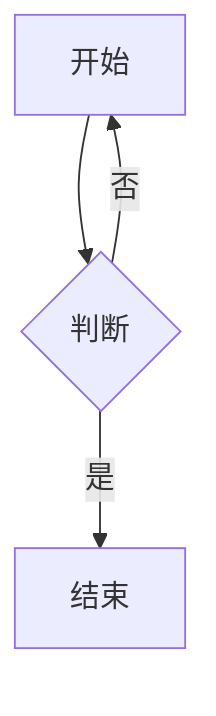

# TodoMy-Next

一个为「长期运行」重新设计的静态博客：**GitHub Issues 写作 + Actions 构建 + Pages 托管**， inherits 原独立版 Gmeek 的全部能力，同时做到：

- **零 pip 依赖**：生成器只用 Python 标准库，彻底告别 `PyGithub / Jinja2 / xpinyin / feedgen` 升级导致的构建崩溃。
- **零外部 CDN / 服务**：所有静态资源本地化；评论直读你自己的 GitHub Issues；访问量用你自己的 Cloudflare Worker + KV。第三方停服不影响你的博客。
- **各类 Markdown 图形**：构建时把 Mermaid 渲染成自包含 SVG 内联进页面，前端不跑任何 JS，20 年后照样显示。
- **跟随而非固定**：runner 用 `ubuntu-latest`、Python 用 `3.x`，永远不会因为「固定版本被退役」而挂掉；配合每周体检 + Dependabot 提前发现破坏。

---

## 1. 它和你原来那套的关系

| 能力 | 原独立版 Gmeek | TodoMy-Next |
|---|---|---|
| 用 Issue 写文章、全量/单篇构建 | ✅ | ✅ |
| 拼音 URL | ✅（xpinyin） | ✅（内置 541KB 拼音表，无依赖） |
| 置顶 / 标签 / 单页 / 自定义参数 | ✅ | ✅ |
| 首页 / 分页 / 文章页 / 标签页 | ✅ | ✅ |
| 全文搜索（标题+正文） | ✅ | ✅ |
| RSS | ✅（feedgen） | ✅（标准库手写 XML） |
| 三态主题 + 夜间模式 | ✅ | ✅ |
| 文章目录 TOC / 图片灯箱 / 返回顶部 | ✅ | ✅ |
| 代码高亮 / GitHub Alerts / 数学公式 | ✅ | ✅（资源本地化） |
| 中 / 英 / 俄 i18n | ✅ | ✅ |
| 访问量 | vercount.one（第三方） | 自托管 Worker（你自己的数据） |
| 评论 | utteranc.es（第三方） | 直读 GitHub Issues（无中间商） |
| **各类 Markdown 图形** | ❌ | ✅ Mermaid 构建时渲染成 SVG |
| 构建依赖 | 6 个 pip 包 | **0 个** |

---

## 2. 目录结构

```
TodoMy-Next/
├── .github/
│   ├── workflows/
│   │   ├── build.yml          # 主构建（发文触发 + 每天全量自检）
│   │   └── healthcheck.yml    # 每周体检（只读，不写文件）
│   └── dependabot.yml         # 依赖/Action 升级自动提 PR
├── generator/
│   └── build.py               # 生成器（941 行，纯标准库）
├── templates/                 # 5 个 Jinja 风格模板（自研引擎渲染）
│   ├── base.html  plist.html  post.html  tag.html  footer.html
├── assets/                    # 本地静态资源（构建时复制到 docs/assets/）
│   ├── primer.css             # GitHub Primer 主题（1.3MB，本地）
│   ├── starry-night.css       # 代码高亮
│   ├── toc.js  lightbox.js  performance.js（大数据优化）
│   ├── comments.js  counter.js  diagram.css
│   └── vendor/tex-mml-chtml.js  # MathJax（本地）
├── counter-worker/            # 自托管计数接口（Cloudflare Workers + KV）
│   ├── src/index.js  wrangler.toml
├── data/pinyin.json           # 内置拼音表（541KB）
├── config.example.json        # 配置样例
└── docs/                      # 生成的站点（构建产物，发布源）
```

---

## 3. 部署步骤

### 3.1 初始化仓库

1. 把本项目上传到一个新仓库（比如 `yourname/yourname.github.io`）。
2. `cp config.example.json config.json`，按注释改成你自己的配置。
3. 仓库 **Settings → Pages → Build and deployment**：
   - Source 选 **Deploy from a branch**
   - Branch 选 **main**，目录选 **/docs**
4. 仓库 **Settings → Actions → General → Workflow permissions**：选 **Read and write permissions**（构建需要 commit 回仓库）。

### 3.2 域名（可选）

如果是 `yourname.github.io` 这种仓库，站点地址是 `https://yourname.github.io`。
config.json 的 `homeUrl` 填这个地址即可。

### 3.3 访问量（可选，自托管）

```bash
cd counter-worker
npx wrangler login
npx wrangler kv namespace create COUNTER_KV       # 把返回的 id 填进 wrangler.toml
npx wrangler secret put ADMIN_TOKEN               # 管理接口的令牌
npx wrangler deploy
```

部署后把 Worker 地址填进 config.json 的 `allHead`：
```json
"allHead": "<script src=\"/assets/counter.js\" data-endpoint=\"https://你的worker.workers.dev\" defer></script>"
```
不填就不显示访问量，页面其余部分照常工作。

### 3.4 发文

新建 GitHub Issue，第一个 label 决定分类（第一个 label 若在 `singlePage` 列表里就是单页，否则是文章）。正文写 Markdown，末尾可加一行配置：

```
正文内容...

##{"timestamp":"1704067200","ogImage":"https://..."}
```

支持 `timestamp / style / script / head / ogImage`。

---

## 4. 各类 Markdown 图形

用 GitHub 标准的 mermaid 代码块即可，构建时会自动渲染成 SVG 内联进文章：

````markdown

````

支持的图类型：流程图 `flowchart/graph`、时序图 `sequenceDiagram`、甘特图 `gantt`、类图 `classDiagram`、状态图 `stateDiagram-v2`、ER 图 `erDiagram`、饼图 `pie`、思维导图 `mindmap`、git 图 `gitGraph`、时间线 `timeline` 等 **Mermaid 全部图种**。

原理见「为什么图形方案能活 20 年」：GitHub 的 Markdown API 只做语法高亮、不渲染图，所以本生成器在**构建时**调用 `mmdc` 渲染成自包含 SVG（0 脚本、0 外链、中文正常），直接内联进 HTML。前端零 JS、零 CDN。

---

## 5. 为什么这套能活 20 年

今天踩的坑（Python 3.8 找不到）本质是「构建没有快照，每次拉最新的，任何一个环节漂移就崩」。本项目从结构上解决：

1. **该动的让它动**：runner = `ubuntu-latest`、Python = `3.x`、Action 由 Dependabot 提 PR 升级。固定版本必被退役，跟随才不会被淘汰。
2. **该静的锁死**：生成器零 pip 依赖、所有静态资源在本地仓库、拼音表内置。运行时不访问任何第三方。
3. **破坏能早发现**：每天全量构建 = 全站自检；每周 healthcheck 冒烟测试（含 mmdc 链路）；坏了一周内必知道，不会等发文时才发现。
4. **图形零依赖**：SVG 是开放标准，任何浏览器原生支持，不依赖 JS 框架或 CDN。

### 年度维护（很小）
- 每年看一眼 Actions 有没有黄色告警，合并 Dependabot 的升级 PR。
- Python `3.x` 会自动跟随；只有当某个大版本 EOL 时（如 3.12 到 2028-10）才需要留意 `3.x` 是否指向新版本——跟随策略会自动处理。

---

## 6. 本地运行（可选）

```bash
# 需要能访问 GitHub API（匿名有 60 次/小时限额，建议设 token）
export CHROME_PATH="/path/to/chrome"       # 本地渲染图形用
export MMDC_BIN="$(npm root -g)/@mermaid-js/mermaid-cli/src/cli.js"
python generator/build.py <token> <owner/repo> --issue_number 0 --workspace $(pwd)
```

`--issue_number 0` = 全量构建；传具体 issue 号 = 只重建那篇。

---

## 7. 与旧项目的迁移

见 `MIGRATION.md`。核心是：文章还在 GitHub Issues 里，内容不用动；只需把 config.json 的字段迁过来，重新部署即可。
